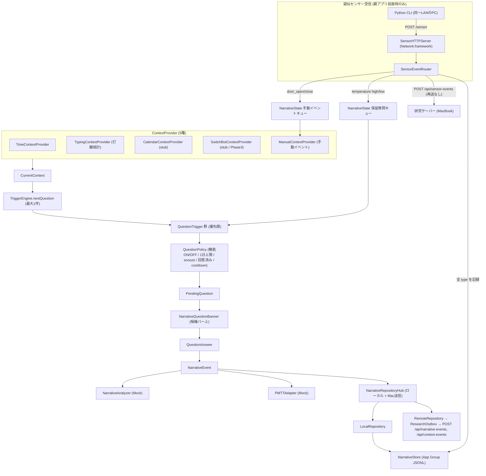

# アーキテクチャ

> 変更: 本書はコードの現状に合わせてあります。研究データの取得範囲・送信経路は [privacy.md](privacy.md)、MacBook 連携の運用は [macbook-lifelog.md](macbook-lifelog.md) を参照してください。

MozcFlickKeyboard は「ホストアプリ」と「Keyboard Extension」の 2 ターゲットから成り、共通ロジックを Shared として共有します。かな漢字変換は Mozc（C++）を Swift から呼び出して実現し、Mozc 未ビルド時は同一プロトコルのローカルスタブへ差し替えて動作します。

---

## 1. 全体構成

```
┌─────────────────────────────┐        ┌──────────────────────────────┐
│  ホストアプリ (App)          │        │  Keyboard Extension (Keyboard) │
│  - くらしのログ（Mac連携）   │        │  - 12キーフリック UI           │
│  - 設定 / 予定・安否確認     │        │  - 入力 → 変換 → 確定          │
│  - お天気分ダッシュボード    │        │  - UITextDocumentProxy 反映     │
│  - 入力ログ・安否確認ログ閲覧│        │  - 入力ログ / お天気分バナー    │
│  - HealthKit/EventKit 取得   │        │  - 研究サーバーへ送信          │
└──────────────┬──────────────┘        └───────────────┬──────────────┘
               │                                        │
               └──────────────┬─────────────────────────┘
                              ▼
                 ┌──────────────────────────┐
                 │  Shared (MozcFlickShared) │
                 │  - JapaneseConversionEngine（プロトコル）
                 │  - PersonalizedConversionEngine（辞書・学習の重ね合わせ）
                 │  - ConversionResult/Candidate/Segment
                 │  - AppConfig（App Group）
                 │  - UserDictionary / Learning
                 │  - KanaTable / KanaTransform / KeyLayout
                 │  - SessionLogger / Narrative / Research
                 └────────────┬─────────────┘
                              ▼
        ┌───────────────────────────────────────────────┐
        │  変換エンジン実装                                │
        │  ┌──────────────────┐  ┌───────────────────────┐│
        │  │ LocalStubEngine   │  │ MozcConversionEngine   ││
        │  │ (純 Swift スタブ) │  │  ↓ ObjC++ ブリッジ     ││
        │  └──────────────────┘  │  ↓ Mozc C++ (session)  ││
        │                        └───────────────────────┘│
        └───────────────────────────────────────────────┘
```

- App / Keyboard は Shared を通じてのみ変換エンジンに触れ、Mozc の C++ 型は一切露出しません。
- `MOZC_AVAILABLE` の有無で `MozcConversionEngine` / `LocalStubEngine` を切り替えます。`project.yml` では実機 SDK（`iphoneos*`）のときだけ `MOZC_AVAILABLE` を定義します。シミュレータでは `LocalStubEngine` で動作します。実機でも Mozc の初期化に失敗した場合（`isMozcAvailable == false`）は `LocalStubEngine` に切り替わります。
- キーボードは、選んだエンジンを `PersonalizedConversionEngine` で包み、ユーザー辞書の候補と学習スコアを重ねます（Full Access が無いと辞書・学習ストアは nil）。

---

## 2. 各ターゲットの責務

| ターゲット | 責務 | 触れないもの |
| --- | --- | --- |
| **App（ホスト）** | タブ「くらしのログ」（Mac ダッシュボード・活動記録・機器名）／「キーボード」（設定・予定・研究設定、お天気分ダッシュボード、入力ログ・安否確認ログ閲覧、ライセンス、デバッグ情報）、HealthKit / EventKit / バッテリーの取得、疑似センサー HTTP 受信 | UITextDocumentProxy（拡張のみ） |
| **Keyboard（拡張）** | フリック UI、入力イベント → 変換エンジン → `UITextDocumentProxy` へ反映、地球儀キー切替、入力ログ記録と送信、お天気分バナー、安否確認表示 | HealthKit / EventKit（親アプリが取得した値を App Group から読むだけ） |
| **Shared** | 変換プロトコル・値型、App Group アクセス、かな変換テーブル、ユーザー辞書・学習ストア、SessionLogger、Narrative、Research（送信クライアント・キュー） | UIKit 依存の最小化 |
| **MozcBridge** | Swift ↔ C++ 境界（ObjC++）。Mozc session を包む | Swift へ C++ 型を漏らさない |

---

## 3. Swift ↔ ObjC++ ↔ C++ 境界

Mozc は C++ で書かれているため、Swift から直接呼べません。以下の 3 層で隔離します。

1. **Swift 層**: `MozcConversionEngine`（`JapaneseConversionEngine` 準拠）。入出力は純 Swift 値型（`ConversionResult` 等）。
2. **ObjC++ 層（MozcBridge）**: `.mm` ファイル。Swift から見える Objective-C クラス（例: `MozcSessionBridge`）を公開し、内部で Mozc の C++ API（`mozc::Session` 等）を呼ぶ。Swift へは `NSString` / プリミティブ / 単純な struct のみ返す。
3. **C++ 層（Mozc）**: `out/mozc` にビルド済みの静的ライブラリ / XCFramework。

境界での型変換方針:

- 文字列は UTF-8（C++）↔ `NSString`/`String`（Swift）。
- 候補配列は ObjC++ 側で `NSArray<NSDictionary>` 等に詰め替え、Swift 側で `ConversionCandidate` に写像。
- Mozc の protobuf メッセージ（`commands::Output` 等）は境界を越えさせない。

---

## 4. Mozc セッション管理

- Keyboard Extension のライフサイクルに合わせて 1 つの Mozc セッションを保持。
- 起動時に一度だけ初期化（辞書ロード）。初期化コストは [performance.md](performance.md) の目標値を参照。
- 入力ごとに `insert` / `requestConversion` を session へ委譲。`commit` でセッションのコンテキストをリセット。
- 拡張がメモリ都合で破棄・再生成される場合に備え、辞書・学習は App Group の永続層へ保存し、セッションは再初期化で復元。

---

## 5. 状態遷移

`JapaneseConversionEngine` を軸にした入力状態:

```
     ┌────────────┐  insert / deleteBackward   ┌───────────────┐
     │  Empty      │ ─────────────────────────▶ │  Composing     │
     │ (composition│ ◀───────────────────────── │ (かな未確定)   │
     │  = "")      │       commit / reset        └──────┬────────┘
     └────────────┘                                     │ requestConversion
            ▲                                            ▼
            │ commit（確定文字列を proxy へ）      ┌───────────────┐
            └──────────────────────────────────── │  Converting    │
                     cancelConversion              │ (文節・候補)   │
                     （Composing へ戻る）           └───────────────┘
```

- **Empty → Composing**: `insert` でかな追加。
- **Composing → Converting**: `requestConversion`（`isConverting=true`、`segments` 生成）。
- **Converting 内**: `selectCandidate` / `moveFocus` / `resizeFocusedSegment` で候補・文節を操作。
- **Converting → Composing**: `cancelConversion`（composition 保持）。
- **→ Empty**: `commit`（確定文字列を返し内部リセット）または `reset`。

拡張側 UI（`KeyboardViewController`）は `UITextDocumentProxy` に marked text API が無いため、未確定文字列（変換中は選択中の文節列）を `syncInline` で入力欄へ実際に挿入します。`pendingComposition` との差分だけを `deleteBackward` / `insertText` で更新し、確定時は挿入済みの分を消してから確定文字列を入れ直します。

---

## 6. 永続化

| データ | 形式 | 場所 |
| --- | --- | --- |
| 設定（トグル入力・フリックのみ・学習・プライベートモード・予定・研究設定） | `UserDefaults(suiteName: AppGroupID)` | App Group |
| ユーザー辞書（`UserDictionaryEntry`） | JSON（Codable） | `UserDictionary/user_dictionary.json` |
| 候補学習（`LearningRecord`: よみ・語・頻度・最終使用） | JSON（Codable、最大5000件） | `Learning/learning.json`（プライベートモード・学習OFF・パスワード欄では書き込まない） |
| 入力ログ | JSONL | `Library/Caches/SessionLogs/` |
| 送信キュー | 1件1ファイルの JSON | `Library/Application Support/PendingResearchSessions/` / `ResearchOutbox/` |
| お天気分 | JSONL | `Narrative/narrative_*.jsonl` / `context_*.jsonl` |
| 安否確認 | JSONL | `SafetyChecks/check_*.jsonl` |
| 端末Context・端末UUID | JSON / 文字列 | App Group UserDefaults（`research.deviceContext` / `research.deviceID`） |

`learning.json` と `user_dictionary.json` にだけ `.completeUntilFirstUserAuthentication` を明示的に設定しています。詳細は [privacy.md](privacy.md)。

---

## 7. App Group

- ID: `group.com.tanaka05.MozcFlickKeyboard`（`Config/Project.xcconfig` の `APP_GROUP_ID`）。
- アクセスは `AppConfig.appGroupID` / `AppConfig.sharedContainerURL` に集約。
- ホスト（設定・予定・端末Context の書き込み、ログ閲覧）と拡張（辞書の読み取り、学習・ログ・回答の書き込み）が同じコンテナを読み書きするため、書き込みは原子的置換（一時ファイル → rename）を推奨。

---

## 8. スレッドモデル

- UI 操作・`UITextDocumentProxy` 反映は**メインスレッド**。
- Mozc 変換呼び出しは短時間で完了する想定のため原則同期呼び出し。重い初期化（辞書ロード）は起動時のバックグラウンドで先読みし、初回入力までに完了を目指す。
- ユーザー辞書の大量入出力（CSV/JSON 数千〜万件）はバックグラウンドキューで実行し、完了後にメインで反映。

---

## 9. エラー設計

- 変換エンジンは**例外を投げない**（プロトコルは throwing でない）。異常時は空の `ConversionResult`（`.empty`）へフォールバックし、UI を壊さない。
- Mozc 初期化失敗時は `LocalStubEngine` へ自動フォールバックし、入力自体は継続可能にする。
- 永続層（辞書 I/O）は throwing。呼び出し側でユーザー通知（ホストアプリ）または握りつぶし（拡張は入力継続優先）を選択。

---

## 10. 採用ビルド方式と理由

- **採用: Bazel（bazelisk）**。理由:
  - Mozc 公式が Bazel ビルドを提供・保守しており、iOS 向けクロスビルド設定を流用できる。
  - 依存（protobuf / abseil 等）のバージョン整合を Bazel が管理し、再現性が高い。
  - CMake/GYP など旧経路より公式サポートが手厚い。
- 具体的な取得元・固定リビジョン・確認済みビルドフラグは [initial-research.md](initial-research.md) を参照（調査担当が確定値を記載）。
- 成果物（`.a` / `.xcframework`）は `out/mozc` に生成し、`scripts/generate_xcode_project.sh` が生成する Xcode プロジェクトへリンクします。

---

## 11. お天気分（Narrative）サブシステム

研究用マイクロ日記「お天気分」は Shared（`MozcFlickShared`）にあります。日常イベントを検知・推定してキーボード上部に質問バナーを1問出し、回答を `NarrativeEvent` として保存します。通常の変換・入力経路には影響せず、回答はホストアプリのテキスト欄（`UITextDocumentProxy`）へ挿入しません。研究データは端末内の JSONL に保存し、Backend URL が設定されていれば（既定は MacBook）永続キュー経由でサーバーへ送ります。詳細な運用・データ形状は [narrative-integration.md](narrative-integration.md)、プライバシー方針は [privacy.md](privacy.md) を参照してください。

処理は「Context → Trigger → Policy → Question → Banner → Answer → NarrativeEvent → Analyzer/PMTT → Repository」の一方向フローです。Backend URL が設定されている場合は、ローカル Trigger より先に `GET /api/questions/pending/{participant_id}` でサーバー側の質問を確認します。疑似センサー入力の経路として「Python CLI（同一 LAN の PC）→ 親アプリの受信サーバー → Router → App Group（キュー / JSONL）→ キーボード」もあります。



- **配置**: 純ロジック（Models / Catalog / State / Store / Repository / Context / Trigger / Policy / TypingMetrics / Analyzer / Recommendation / PMTT / Sensor の Router）は Shared に置き、UI（`NarrativeQuestionBanner`）は Keyboard 拡張、ダッシュボードと受信サーバー（`SensorHTTPServer`）は App に置く。UITextDocumentProxy へ触れるのは従来どおり Keyboard 拡張のみで、回答経路はそこを構造的に呼ばない。
- **状態と保存**: 出題制御の状態は App Group `UserDefaults`（`NarrativeState`）に、イベント本体は App Group 共有コンテナの `Narrative/*.jsonl`（`NarrativeStore`。既存の `SafetyCheckLog` と同じく throw しない）に置く。日付別ファイルは `narrative_yyyyMMdd.jsonl` と `context_yyyyMMdd.jsonl` の2種類。旧版の `unsent_narrative.jsonl` は読み込んだら `ResearchOutbox` へ移行する。
- **保存先**: `NarrativeRepositoryHub(baseURL:)` は `LocalRepository`（必ず保存）と `RemoteRepository`（`ResearchEventOutbox` に1件1ファイルで積んで POST。成功した分だけ削除）を包む。Backend URL が空ならキューに残るだけで送信しない。
- **疑似センサー受信**: 親アプリが Network.framework（`NWListener` + TCP）で `POST /sensor` を待ち受け、`SensorEventRouter` が「手動イベントキュー（外出/帰宅）」「保留質問キュー（疲労チェック）」「`ContextEvent`（`sensor_<type>` / `source="sensor"`）」へ振り分ける。キーボードへは App Group 経由で橋渡しし、次回のキーボード表示または 60 秒チェックで拾われる。iOS の制約により**親アプリが前面のときだけ**受信でき、`SceneDelegate` の active/背面で start/stop する（設定 ON のときのみ）。

- **端末Context（HealthKit 活動量）**: 親アプリの `ResearchContextCollector` が HealthKit を読み取りのみで取得し、App Group の `ResearchDeviceContext` へ保存する。合計系（歩数 / 歩行距離 / 登った階段 / 活動エネルギー）は今日0時〜現在、平均系（歩行速度 / 歩幅 / 歩行非対称性）は直近1時間で集計する。`HKObserverQuery` + `enableBackgroundDelivery(.hourly)`（`AppDelegate.didFinishLaunching` で起動）によりバックグラウンドでも約1時間ごとに更新する。キーボード拡張は HealthKit を直接扱えないため、下部「情報」ボタンの Info ページ（`NarrativeQuestionBanner.showInfo`）で App Group の保存値を全画面表示するだけに留める。これらは `ResearchSessionUpload.context` としてサーバー送信にも含まれる。
- **エラー設計**: 既存方針に合わせ、保存は throw しない（失敗はログのみで入力継続を最優先）。受信サーバーも失敗時はログを出して停止するだけで、キーボードの動作には影響しない。
- **フェーズゲート**: 有効な Trigger は `SensorPendingTrigger` / 外出 / 帰宅 / 朝 / 夜の5つ。`TypingFatigueTrigger` / `LongSessionTrigger` は同梱しているが既定は `enabled=false`（Phase 2）。`CalendarContextProvider` と `SwitchBotContextProvider` は stub（SwitchBot の実データは Mac 側で BLE 収集し、ダッシュボードに表示するだけ）。`NarrativeAnalyzer` / `PMTTAdapter` / `RecommendationEngine` は Mock 実装で、CoreML / LLM などへ差し替えられるようプロトコル境界を用意している（Phase 4）。
