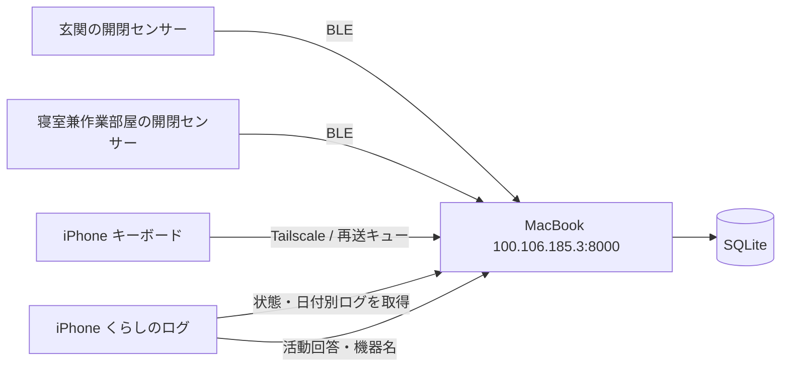

# MacBook + SwitchBot 統合ログ

アプリの初期タブ「くらしのログ」に、玄関・寝室兼作業部屋のSwitchBot状態、現在の活動、日別のまとめ、キーボード・回答・開閉イベントのタイムラインを表示します。既存のキーボード設定やローカル入力ログは「キーボード」タブにあります。



## 利用開始

1. MacでTailscale・BluetoothをONにします。サーバーのコードは `/Users/tanakashunsuke/Desktop/python/20261008`、接続先は `http://100.106.185.3:8000` です。自動起動は同ディレクトリの `service.py` で管理します。詳細は同ディレクトリの `README.md` を参照してください。
2. このプロジェクトをXcodeで開き、App / Extension / Sharedの署名用TeamとApp Groupを確認し、iPhoneへRunします。実機の接続・署名が必要です。
3. iPhoneのTailscaleをONにします。アプリの「くらしのログ」でMac接続を確認します。設定の参加者IDは `p001`。初期URLは上記Macです。以前空欄を保存していた場合は画面の「このMacBookに接続する」、別URLを保存していた場合は歯車から変更します。
4. iOS設定のキーボードでMozcFlickのフルアクセスを許可し、アプリのプライベートモードをOFFにします。
5. 片方ずつドアを開閉して機器を識別し、機器行をタップして「玄関」「寝室兼作業部屋」と名付けます。名称を保存するにはMacへの接続が必要です。
6. キーボードを使い終えてアプリを開くとログを同期します。連続入力中も60秒ごとにセッションを確定します。「活動を記録」から本人の行動を追記でき、オフライン中は送信待ちになります。

「疑似センサー受信」は今回の接続には不要です。iPhoneアプリが閉じている間もMacでBLE収集を継続します。アプリ画面は前面で15秒ごとに更新されます。

## 表示の意味

- 現在の活動は30分以内の回答または2分以内の打鍵を根拠に表示します。本人の回答・推定・情報不足を区別します。ドアだけで在宅・外出を確定しません。
- SwitchBotは最終受信時刻・電池・開閉状態を表示し、120秒以上未受信なら「現在不明」です。接続断時の画面には保存済みの情報であることを表示します。
- 日付選択は日本時間の1日を指定します。「いまの状況」「SwitchBot」は常に現在の最終情報で、日別まとめとタイムラインだけが選択日に切り替わります。
- 集計は入力セッションの終了日を基準にします。初回のセンサー受信は開閉回数には含めません。タイムラインは100件ずつ読み込み、追加ページは同じスナップショットに固定します。
- 歩数・歩行距離・iPhone電池は最新送信セッションに含まれるContextで、取得時刻を併記します。iOSのすべてのアプリの行動を観測する機能ではありません。
- ログ詳細には保存データをJSONで表示します。入力本文や文脈が含まれる場合があります。

## 実装と互換性

- `App/LifeLogDashboardViewController.swift`: タブ、接続表示、活動登録、機器名、日付切り替え、詳細。
- `App/LifeLogAPI.swift`: 認識可能なHTTPエラー、同期→取得、ISO8601、接続先・参加者・日付ごとに分けたオフラインキャッシュ。
- `Shared/Research/ResearchEventOutbox.swift`: 回答・文脈の永続キュー。1ファイル1イベント、成功したイベントだけを削除します。
- `ResearchAPIClient`: 送信中のクライアントを保持して再送を継続します。未送信セッションをCachesからApplication Supportへ移行します。
- `SessionLogger`: 無入力・非表示・60秒間隔でセッションを閉じます。間隔で閉じた後も次の入力を記録します。
- `NarrativeRepositoryHub`: ローカル保存とMac同期。旧 `unsent_narrative.jsonl` は個別イベントキューへ移行します。

以前に送信キューへ積まれなかったローカルセッション・文脈ファイル全体の自動インポートは行いません。iOSが確定前に拡張を強制終了した場合の生ログは、既存のローカル入力ログに残っていてもMacへ未送信の場合があります。

新規設定のBackend URLはMacを既定にしています。明示的な空文字設定は維持され、空欄にすると送信・取得を停止します。App Group / フルアクセスがない場合、キーボードのログは記録できません。

## 検証コマンド

```sh
xcodegen generate
xcodebuild -project MozcFlickKeyboard.xcodeproj -scheme MozcFlickKeyboard \
  -sdk iphonesimulator -destination 'platform=iOS Simulator,name=iPhone 16 Pro,OS=18.0' \
  CODE_SIGNING_ALLOWED=NO build
```

追加の `SessionRotationTests` は周期確定後の入力継続・無入力後の再開・非表示後の記録停止を検証します。サーバーのpytestはサーバーディレクトリで実行します。

### 今回の確認結果（2026-10-14）

- iOS Simulator / iPhone実機向けの両SDKでビルド成功（実機向けは署名なしのコンパイル確認）。
- `NarrativeTriggerTests` 22件と `SessionRotationTests` 2件に合格。
- シミュレーターのUIテストで接続済み表示・活動の2段階選択・キーボードタブへの移動に合格。スクリーンショットで統合画面・タイムラインを確認。
- サーバーpytest 8件に合格。Mac上でLaunchAgentを起動し、HTTP接続と実際の開閉センサー1台のBLE受信を確認。
- 全体の既存テスト73件では、変更していない `ConversionCaseTests` と `FlickTests.testShortButFastIsFlick` に合計11個のassertion失敗（6テストメソッド）。変換スタブの語彙・日付候補、短距離フリックの期待値に関するものです。
- iPhone実機がXcodeから利用可能な状態ではないため、実機インストール・iPhone→Tailscaleの疎通・2台の場所対応付けは未確認です。
