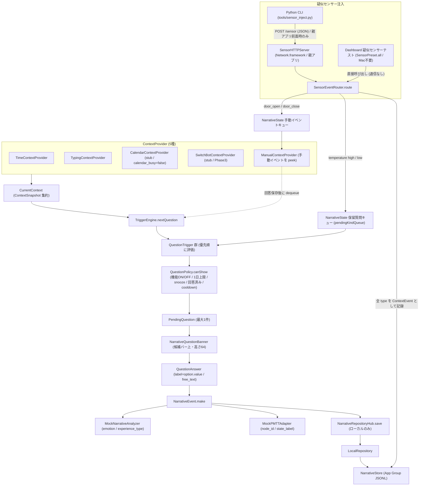

# お天気分（Narrative micro-diary）統合 完了報告

> MacBook統合版の現行仕様は [macbook-lifelog.md](macbook-lifelog.md) を参照してください。以下のPhase 1設計にある「ローカルのみ」「送信機能は削除済み」の記述は旧仕様です。現在は入力セッション・回答・文脈をMacに同期します。

既存の MozcFlick キーボードを壊さずに、研究用マイクロ日記「お天気分」を Phase 1 として統合した。日常イベント（起床・外出・帰宅・就寝や時間帯）を検知／推定し、キーボード上部にバナー質問を1問だけ出す。ユーザーは 1〜2 タップまたは短い自由記述で回答し、回答は `NarrativeEvent` として研究データに保存される（ホストアプリの入力欄には一切挿入しない）。研究データは**端末内の App Group JSONL のみ**に保存し、外部送信は行わない。

加えて、実センサーが無い段階でも研究フローを動かせるように、**同一 LAN の MacBook から親アプリへ疑似センサーイベントを注入する経路**と、**Mac を使わず親アプリ内のボタンから直接注入するテストモード**を用意した（玄関開閉 → 外出/帰宅、温度 high/low → 疲労チェック、トイレ/在室検知/中温 → 記録のみ）。HTTP 受信は親アプリを前面で開いている間だけ可能で、既定は OFF。アプリ内テストモードはネットワークを使わないため常に使える。

対象コード: `MozcFlickKeyboard/Shared/Narrative/`（`Sensor/SensorEventRouter.swift` を含む）, `MozcFlickKeyboard/Keyboard/Narrative/`, `MozcFlickKeyboard/App/NarrativeDashboardViewController.swift`, `MozcFlickKeyboard/App/Sensor/SensorHTTPServer.swift`, `tools/sensor_inject.py`, および変更した Keyboard / App の各ファイル。

---

### Architecture



- 通常入力はこの経路と独立して動作し、`textDocumentProxy` へは通常入力のみが反映される。回答経路は `textDocumentProxy` を構造的に一切呼ばない。
- Trigger の優先順（`TriggerEngine.makeDefault`）は `SensorPending > Outing > ReturnHome > Morning > NightReflection > TypingFatigue(無効) > LongSession(無効)`。`Policy.canShow` を通った最初の1件だけを採用する。
- 研究データは**端末内 JSONL のみ**に保存し、外部送信は行わない（バックエンド送信は削除済み）。`NarrativeRepositoryHub` は `LocalRepository` だけを包む。

---

### 実装した Trigger 一覧

`TriggerEngine.makeDefault(state:)` が登録する 7 Trigger（優先順）。優先順は **センサー保留 > 外出 > 帰宅 > 朝 > 夜 > 疲労(無効) > 長時間(無効)**。上 5 つが有効、下 2 つは `enabled = false` で同梱のみ。

| Trigger | Phase | 有効 | 発火条件 | 生成 QuestionKind / event_type | external_trigger |
| --- | --- | --- | --- | --- | --- |
| `SensorPendingTrigger` | 1 | 有効 | 疑似センサー由来の保留質問キュー（`NarrativeState.peekPendingKinds()`）に1件以上ある。最も古い1件の `QuestionKind` をそのまま出題 | キューの `QuestionKind`（例 `fatigueCheck`）/ `sensor_pending` | `sensor` |
| `OutingTrigger` | 1 | 有効 | 手動イベント `outing`（外出した）がキューにある。疑似センサーの `door_open` もここへ入る | `outingDestination` / `outing` | `manual_outing` |
| `ReturnHomeTrigger` | 1 | 有効 | 手動イベント `return_home`（帰宅した）がキューにある。疑似センサーの `door_close` もここへ入る | `outingEvaluation` / `return_home` | `manual_return_home` |
| `MorningTrigger` | 1 | 有効 | 当日初回のキーボード利用 かつ 06〜10 時台（`NarrativeConfig.morningHours = 6...10`） | `morningMood` / `wake_up` | なし |
| `NightReflectionTrigger` | 1 | 有効 | 手動イベント `sleep`（寝る）がある、または 21 時以降〜翌 2 時（`nightStartHour=21` / `nightEndHour=2`） | `nightReflection` / `night_reflection` | なし |
| `TypingFatigueTrigger` | 2 | 無効（既定 `enabled=false`） | 打鍵ベースラインと現在特徴の乖離（`TypingMetrics.deviation`）。両方の特徴が揃うときのみ | `fatigueCheck` / `typing_fatigue` | なし |
| `LongSessionTrigger` | 2 | 無効（既定 `enabled=false`） | セッション継続時間が `continuousTypingThreshold = 30分` 以上 | `workState` / `long_session` | なし |

> 補足: `morningGoal` / `breakCheck` / `freeNarrative` / `interventionFeedback` は Trigger 未接続（テンプレートのみ定義済み）で、Phase 1 では出題されない。`SensorPendingTrigger` は任意の `QuestionKind` を出せるため、将来のセンサー質問はここへ積むだけで拡張できる。
> Policy の扱い: センサー由来（`pendingKindQueue` に載っている種別）は、外出/帰宅と同じく「当日既に回答済みなら出さない」制約を**免除**する（毎回が新規の実事象なので、温度 high を2回注入したら2回とも出る）。ただし **cooldown（`fatigueCheck` は 60 分）と1日上限（`maxQuestionsPerDay = 5`）は免除しない**ため出しすぎにはならない。cooldown 中はキューに残り、明けてから出題される。
> キューの消費契約: 手動イベント由来（`outingDestination` / `outingEvaluation`）は回答保存後に `dequeueAllManualEvents()`、センサー保留由来（`eventType == "sensor_pending"`）は `dequeuePendingKinds()` を `KeyboardViewController.consumeManualEventsIfNeeded` が呼ぶ。

---

### Question 一覧

全 10 種の `QuestionKind`（`QuestionCatalog.template(for:)` 定義）。`options` は表示ラベル（保存 value は括弧内）。`maxPerDay` の `max` は `NarrativeConfig.maxQuestionsPerDay = 5`。

| QuestionKind | prompt | options（label / value） | allowFreeText | cooldown | maxPerDay |
| --- | --- | --- | --- | --- | --- |
| `morningMood` | 今朝の気分はどうですか？ | 良い(good) / 普通(normal) / 少し疲れた(slightly_tired) / 悪い(bad) | false | 0 | 1 |
| `morningGoal` | 今日はどんな1日にしたいですか？ | 仕事を進めたい(work) / ゆっくりしたい(rest) / 外出したい(going_out) | true | 0 | 1 |
| `nightReflection` | 今日はどんな1日でしたか？ | 良かった(good) / 普通(normal) / 大変だった(difficult) | true | 0 | 1 |
| `outingDestination` | どこへ行きましたか？ | 仕事(work) / 買い物(shopping) / 散歩(walk) / 食事(meal) / 病院(hospital) / その他(other) | false | 0 | 5 |
| `outingEvaluation` | 今回の外出はどうでしたか？ | 良かった(good) / 普通(normal) / 疲れた(tired) / 大変だった(difficult) | false | 0 | 5 |
| `workState` | 今はどれに近いですか？ | 作業中(working) / 休憩中(break) / 疲れた(tired) / その他(other) | false | 60分 | 5 |
| `fatigueCheck` | 少し疲れていますか？ | はい(yes) / いいえ(no) | false | 60分 | 5 |
| `breakCheck` | 少し休憩しますか？ | する(yes) / しない(no) | false | 60分 | 5 |
| `freeNarrative` | 印象に残ったことはありますか？ | 仕事(work) / 家族(family) / 外出(going_out) / 食事(meal) / その他(other) | true | 0 | 5 |
| `interventionFeedback` | 今の提案は役に立ちましたか？ | 役に立った(helpful) / 普通(neutral) / 役に立たなかった(not_helpful) | false | 0 | 5 |

> 実装メモ: 選択肢を回答すると `QuestionAnswer.label` には **option の `value`**（snake_case 英語）が入る（`label` という名前だが表示ラベルではない）。`cooldown > 0` の種別（workState / fatigueCheck / breakCheck）は前回表示から 60 分未満なら再出題しない。`outingDestination` / `outingEvaluation` は「当日回答済みなら出さない」制約を免除（外出のたびに新規事象のため）。それ以外は当日1回で `maxPerDay=1` を実質的に満たす。

---

### データモデル

すべて `Codable`。保存 JSON のキーは研究ログ仕様に合わせて snake_case（`CodingKeys` で明示）。日付は `yyyy-MM-dd'T'HH:mm:ss.SSSZ`（`en_US_POSIX`、既存 `SafetyCheckLog` と同一書式）。

- **`ContextSnapshot`**: `time_of_day`（morning/afternoon/evening/night）/ `typing_active`（Bool）/ `calendar_busy`（Bool、Phase1 は常に false）/ `external_trigger`（String?）。
- **`TypingFeatures`**: `typing_speed_cpm` / `backspace_rate` / `mean_key_interval_ms` / `session_duration_sec` / `backspace_count` / `total_typed_characters` / `pause_count` / `long_pause_duration_sec`。**本文は一切含まず、時刻・回数から算出した統計量のみ**。
- **`ContextEvent`**（質問を伴わない記録。`context_yyyyMMdd.jsonl`）: `event_id` / `participant_id` / `event_type`（wake_up、疑似センサーなら `sensor_<type>`）/ `detected_at` / `source`（keyboard / parent_app / sensor）/ `context`（`ContextSnapshot`）/ `typing`（`TypingFeatures?`）。
- **`PendingQuestion`**（出題中の保持オブジェクト。保存はしない）: `id` / `participantID` / `kind` / `prompt` / `options` / `allowFreeText` / `eventType` / `detectedAt` / `questionShownAt?` / `snoozeCount` / `context`。
- **`QuestionAnswer`**: `label`（選択肢の value。未選択なら nil）/ `free_text`（自由記述。無ければ nil）。
- **`NarrativeAnalysis`**: `emotion`（positive/neutral/negative）/ `experience_type`（success/failure/partial_success/neutral）/ `embedding`（Phase1 は nil）。
- **`PMTTContext`**（`NarrativeEvent.pmtt` に埋め込む）/ **`PMTTLink`**（PMTT 側から参照する対応表1件）: いずれも `node_id` / `state_label` / `transition_id`（`PMTTLink` は加えて `event_id`）。
- **`InterventionEvent`**: `id` / `participant_id` / `narrative_event_id` / `kind` / `outcome`（accepted/declined/ignored、未確定なら nil）/ `created_at`。Phase1 では未生成（`RecommendationEngine` が常に nil のため）。
- **`SensorEvent`**（疑似センサーから受け取る1件。HTTP body の JSON に対応。`Codable`）: `type`（`door_open` / `door_close` / `toilet` / `temperature` / `living_presence`）/ `value`（`String?`。温度は `high` / `mid` / `low`、在室検知は `present`（在室）/ `absent`（不在））/ `at`（`Date?`。省略時は受信時刻を使う）。**保存はされず**、`SensorEventRouter` を通じて `ContextEvent` とキュー投入に変換される。
- **`SensorRouteResult`**（`SensorEventRouter.route` の戻り値。保存しない）: `manualEvent`（`ManualEvent?`。外出 / 帰宅）/ `pendingKind`（`QuestionKind?`。疲労チェック等）/ `contextEventType`（常に `"sensor_<type>"`）/ `isUnknownType`（未知の type だったか。CLI 側のタイプミス検知用）。未知の type でも記録は必ず行うため、研究ログは欠損しない。
- **`sensor_*` の ContextEvent**: 疑似センサーの**全 type** が `event_type = "sensor_<type>"`（例 `sensor_door_open` / `sensor_temperature` / `sensor_toilet` / `sensor_living_presence`）、`source = "sensor"` で記録される。`context.external_trigger` には値付きで `"sensor:<type>=<value>"`（値が無ければ `"sensor:<type>"`）が入る。`typing_active` / `calendar_busy` は受信時に判定しないため常に `false`。
- **`NarrativeEvent`**（回答済み micro-diary 1件。`narrative_yyyyMMdd.jsonl` の1行）: `question` / `answer` / `narrative` をネストする。`NarrativeEvent.make(from:answer:typing:answeredAt:)` で `PendingQuestion` + 回答から生成し、`source = "keyboard"` 固定、`summary` は選択肢 value と自由記述を ` / ` 連結した最小要約。

`NarrativeEvent` の JSON 形状（例）:

```json
{
  "event_id": "F1E2D3C4-....",
  "participant_id": "p001",
  "source": "keyboard",
  "event_type": "wake_up",
  "detected_at": "2026-09-15T07:12:03.421+0900",
  "question_shown_at": "2026-09-15T07:12:03.421+0900",
  "answered_at": "2026-09-15T07:12:09.880+0900",
  "context": {
    "time_of_day": "morning",
    "typing_active": true,
    "calendar_busy": false,
    "external_trigger": null
  },
  "question": { "kind": "morningMood", "prompt": "今朝の気分はどうですか？" },
  "answer": { "label": "good", "free_text": null },
  "narrative": { "summary": "good", "emotion": "positive", "experience_type": "success" },
  "typing": {
    "typing_speed_cpm": 210.5,
    "backspace_rate": 0.08,
    "mean_key_interval_ms": 285.0,
    "session_duration_sec": 42.0,
    "backspace_count": 2,
    "total_typed_characters": 25,
    "pause_count": 1,
    "long_pause_duration_sec": 3.1
  },
  "pmtt": { "node_id": "weekday_morning_desk_work", "state_label": "positive", "transition_id": null },
  "snooze_count": 0
}
```

---

### 変更ファイル

**新規（`MozcFlickKeyboard/Shared/Narrative/`）**

- `NarrativeModels.swift` — Codable モデル一式（`QuestionKind`(10) / `QuestionTemplate` / `QuestionOption` / `PendingQuestion` / `ContextSnapshot` / `TypingFeatures` / `QuestionAnswer` / `ContextEvent` / `NarrativeEvent`(+`.make`) / `NarrativeAnalysis` / `InterventionEvent` / `PMTTContext` / `PMTTLink` / `CurrentContext` / `ManualEvent` / `TriggerResult` / `TimeOfDay` / `NarrativeJSON`）
- `QuestionCatalog.swift` — 全 10 `QuestionTemplate` + `NarrativeConfig`（ハイパーパラメータ）
- `NarrativeState.swift` — App Group `UserDefaults` の状態（回答済み / lastShown / snooze / 初回・最終キーボード利用 / 手動イベントキュー / **センサー由来の保留質問キュー** / 打鍵ベースライン EMA / 研究設定）。キーは `NarrativeSettingsKeys`（`narrative.` 接頭辞）
- `NarrativeStore.swift` — App Group `Narrative/` への JSONL 追記・読み出し（`narrative_yyyyMMdd.jsonl` / `context_yyyyMMdd.jsonl` の2種のみ）+ `NarrativeExport`（JSON / CSV）
- `NarrativeRepository.swift` — `LocalRepository` / `NarrativeRepositoryHub`（ローカル保存のみ）
- `Context/ContextProvider.swift` — `ContextProvider` プロトコル + `ContextFragment` + 5 実装
- `Trigger/QuestionTrigger.swift` — `QuestionTrigger` プロトコル + 7 Trigger
- `Trigger/TriggerEngine.swift` — `TriggerEngine`（`makeDefault` / `nextQuestion`）
- `Sensor/SensorEventRouter.swift` — **追加**: `SensorEvent` / `SensorRouteResult` / `SensorEventRouter`（受信イベント → 手動イベントキュー・保留質問キュー・`ContextEvent`）+ **追加**: `SensorPreset`（アプリ内テストモード用のプリセット定義。`title` / `type` / `value` / `makeEvent(at:)` / `static var all`（8種））
- `QuestionPolicy.swift` — 出題可否ゲート
- `TypingMetrics.swift` — 打鍵統計の集計（本文なし）+ `deviation(current:baseline:)`
- `NarrativeAnalyzer.swift` — `NarrativeAnalyzer` プロトコル + `MockNarrativeAnalyzer`
- `RecommendationEngine.swift` — `RecommendationEngine` プロトコル + `Suggestion` + `MockRecommendationEngine`（常に nil）
- `PMTTAdapter.swift` — `PMTTAdapter` プロトコル + `MockPMTTAdapter`

**新規（Keyboard / App / tools）**

- `Keyboard/Narrative/NarrativeQuestionBanner.swift` — 質問バナー View（選択肢 / あとで / 自由入力 / 自由記述モード / 手動イベント4ボタン）
- `App/NarrativeDashboardViewController.swift` — 親アプリ「お天気分」ダッシュボード
- `App/Sensor/SensorHTTPServer.swift` — **追加**: Network.framework（`NWListener` + TCP）による最小 HTTP 受信サーバー。`POST /sensor` のみ受け付けて `200 {"ok":true}` を返す。`shared` シングルトン / `start(port:)` / `stop()` / `isRunning` / `activePort` / `onEventReceived` / `static currentWiFiIPAddress()`（en0 の IPv4 を表示用に取得）
- `tools/sensor_inject.py` — **追加**: 疑似センサー注入 CLI（Python 標準ライブラリのみ）
- `tools/README_sensor.md` — **追加**: CLI の使い方・トラブルシューティング

**変更**

- `Keyboard/Flick/KeyboardView.swift` — 候補バー上に `questionBanner`（`bannerHeightConstraint` 既定0）、infoBar に「記録」ボタン、公開 API（`showQuestion` / `hideQuestion` / `showManualEventPicker` / `setResearchDraft` / `setResearchFreeTextMode`）とコールバック
- `Keyboard/KeyboardViewController.swift` — `viewWillAppear` と 60 秒 `checkTimer` で `evaluateNarrativeTriggers()`（安否確認 `pendingCheck` が無く機能 ON のときのみ）、回答フロー、研究入力モード分岐、`TypingMetrics` feed。**変更**: `NarrativeRepositoryHub()` を引数なしで生成（送信先 URL 引数と再送呼び出しは撤去）、`consumeManualEventsIfNeeded` が `eventType == "sensor_pending"` のとき保留質問キューを `dequeuePendingKinds()` で消費
- `App/RootViewController.swift` — 「お天気分」行を追加し Dashboard へ遷移
- `App/SettingsViewController.swift` — 「研究設定（お天気分）」セクション（**5行**: 参加者ID / 質問機能 ON・OFF / 疑似センサー受信 ON・OFF / 受信ポート（既定 8770）/ 接続先案内）。**旧「送信先 URL」行は削除**
- `App/SceneDelegate.swift` — **変更**: `sceneDidBecomeActive` で（`sensorReceiveEnabled` が true のときだけ）`SensorHTTPServer.shared.start(port:)`、`sceneWillResignActive` / `sceneDidEnterBackground` で `stop()`
- `App/NarrativeDashboardViewController.swift` — **変更**: 「疑似センサー（このアプリを開いている間だけ受信）」セクション（受信状態 / 最後の受信）を追加。`SensorHTTPServer.shared.onEventReceived` で受信時に即再描画。**追加**: 「疑似センサーテスト（Mac不要・タップで直接注入）」セクション（`SensorPreset.all` の8ボタン。`injectSensorPreset(_:)` が `SensorEventRouter.route` を直接呼び、結果をアラートで通知）
- `App/Info.plist` — **変更**: `NSLocalNetworkUsageDescription` を追加（iOS 14+ のローカルネットワーク許可）

**削除**

- `NarrativeRepository.swift` のバックエンド送信クラス（URLSession による `POST`）と `NarrativeRepositoryHub` の送信経路・再送メソッド
- `NarrativeStore.swift` の送信退避キュー（未送信 JSONL とその追記・読み出し・削除・URL 取得の各メソッド）
- `NarrativeState.swift` の送信先ベース URL プロパティとそのキー、設定画面の送信先 URL 入力行

**テスト**

- `Tests/NarrativeTriggerTests.swift` — 朝／夜／手動外出・帰宅／snooze／翌日／機能OFF／CSV エスケープ／打鍵統計、および `SensorEventRouter` のマッピング を `now` 注入 + 一時 `UserDefaults` で検証（`SensorHTTPServer` はネットワークのため手動確認）

---

### Parent App の操作方法

1. ホストアプリを起動し、トップ（`RootViewController`）の **「お天気分」** 行をタップして `NarrativeDashboardViewController` を開く。
2. **今日の記録**: 起床 / 朝の気分 / 外出（回数と最新の行き先）/ 帰宅 / 夜の振り返り / 回答した質問数 を当日の JSONL から集計表示（`viewWillAppear` ごとに再計算）。
3. **疑似センサー（このアプリを開いている間だけ受信）**: 「受信状態」に `受信中 / 停止中` と `IP:ポート` を表示（設定が OFF なら「OFF（設定で有効化）」）。「最後の受信」に `type=value HH:mm:ss` を表示（未受信は `—`）。受信すると `SensorHTTPServer.shared.onEventReceived` 経由でその場で更新される。
4. **疑似センサーテスト（Mac不要・タップで直接注入）**: `SensorPreset.all` の8プリセット（玄関開 / 玄関閉 / トイレ / 在室 / 不在 / 温度 高い・ふつう・低い）がボタンとして並び、サブタイトルに実際の `type=value` が出る。タップすると `SensorEventRouter.route` を直接呼び（HTTP を使わない）、次に起きること（予約された質問 or 記録のみ）をアラートで表示する。Mac も Wi-Fi もローカルネットワーク許可も不要で、受信 ON/OFF に関係なく動く。
5. **手動イベント**: 「起きた」「外出した」「帰宅した」「寝る」をタップすると `NarrativeState.enqueueManualEvent` でキューへ積む（確認アラートを表示）。積んだイベントは次回キーボード表示時に Trigger が拾う。Python CLI が無くても動く冗長経路。
6. **エクスポート**: 「JSONで書き出し」/「CSVで書き出し」をタップすると、保存済み全 `narrative_*.jsonl` を集約して一時ファイルへ書き出し、`UIActivityViewController`（共有シート）で AirDrop / ファイル保存 等ができる。
7. **研究設定**: 設定画面（`SettingsViewController`）の **「研究設定（お天気分）」** セクション（5行）で、参加者ID（既定 `p001`）/ 質問機能 ON・OFF / 疑似センサー受信 ON・OFF（既定 OFF）/ 受信ポート（既定 `8770`）/ 接続先（稼働状態・iPhone の LAN IP・そのまま貼れる `python3` コマンド）を確認・編集する。値は App Group `UserDefaults` に保存され、キーボード拡張と共有される。

### Keyboard の操作方法

- **質問の出現**: キーボード表示時（`viewWillAppear`）と 60 秒ごとに Trigger を評価し、条件成立時に候補バーの上へ質問バナー（高さ 64pt）が1問だけ出る。質問が無いときはバナー高さ 0 で完全非表示（入力領域は圧迫されない）。安否確認が表示中は Narrative 質問を出さない。
- **回答**: 選択肢ボタンをタップすると即保存してバナーが閉じる。
- **あとで**: 「あとで」をタップすると 30 分後まで同じ種別を再表示しない（`snoozeInterval`）。
- **自由入力**: `allowFreeText=true` の質問で「自由入力」をタップすると研究入力モードに入り、以降のフリック入力は研究用の下書き（`researchDraft`）へ流れる（**`textDocumentProxy` には一切入力されない**）。「決定」で `free_text` として保存、「キャンセル」で選択肢表示へ戻る。
- **記録ボタン**: infoBar の「記録」を押すと手動イベント4ボタン（起きた / 外出した / 帰宅した / 寝る）を展開。「起きた」は即 `ContextEvent`（wake_up）として保存、「外出した」「帰宅した」「寝る」はキューへ積み、直後に再評価して該当質問（外出先・外出評価・夜の振り返り）を出す。

---

### 疑似センサー注入方法（アプリ内テストモード / Python CLI）

実センサーが無い段階でも研究フローを動かせるように、疑似センサーイベントを注入する経路を2つ用意した。

| 経路 | 必要なもの | 用途 |
| --- | --- | --- |
| **アプリ内テストモード**（Dashboard のプリセットボタン） | iPhone だけ | **最も簡単**。ネットワーク不要でその場で動作確認する |
| Python CLI（`tools/sensor_inject.py`） | 同一 Wi-Fi の Mac + 受信 ON | LAN / 遠隔から任意タイミングで注入する |

どちらも最終的に**同じ `SensorEventRouter.route(_:)`** を通るため、キュー投入・`ContextEvent` 記録・ログ出力の挙動は完全に同じになる。

#### アプリ内テストモード（Mac不要）— 追加

親アプリ Dashboard の **「疑似センサーテスト（Mac不要・タップで直接注入）」** セクションに、`SensorPreset.all`（8種）がそのままボタンとして並ぶ。各行のサブタイトルには実際に送られる `type=value` が表示される。

| ボタン | `type` | `value` |
| --- | --- | --- |
| 玄関を開けた（外出） | `door_open` | なし |
| 玄関を閉めた（帰宅） | `door_close` | なし |
| トイレ | `toilet` | なし |
| 在室（リビングにいる） | `living_presence` | `present` |
| 不在（リビングにいない） | `living_presence` | `absent` |
| 温度 高い | `temperature` | `high` |
| 温度 ふつう | `temperature` | `mid` |
| 温度 低い | `temperature` | `low` |

- タップすると `SensorEventRouter.route(_:)` を**直接**呼ぶ（HTTP を経由しない）。したがって **Mac 不要 / 同一 Wi-Fi 不要 / ローカルネットワーク許可不要 / 「疑似センサー受信」設定の ON 不要**で動く。
- 実際の HTTP 注入とまったく同じ経路（振り分け・キュー・ログ）を通るため、これで確認できた挙動は実センサー経路でもそのまま再現される。
- 注入後、次に何が起きるかをアラートで明示する（積まれた質問のプロンプト、または「文脈として記録しました（質問は出ません）」）。
- 実装: `SensorPreset`（`Shared/Narrative/Sensor/SensorEventRouter.swift`。`title` / `type` / `value` / `makeEvent(at:)` / `static var all`）+ `NarrativeDashboardViewController.injectSensorPreset(_:)`。デバッグログは `[MFK-Sensor] dashboard inject type=... value=...`。

#### Python CLI（同一 LAN の Mac から注入）

同一 LAN の MacBook から親アプリへ疑似センサーイベントを HTTP POST で注入する。CLI は `tools/sensor_inject.py`（Python 標準ライブラリのみ・pip 不要）、詳しい使い方は [../tools/README_sensor.md](../tools/README_sensor.md)。

**前提（すべて満たす必要がある）**

1. iPhone と Mac が**同一 Wi-Fi（同一サブネット）**にいる。
2. 親アプリを**前面で開いている**。iOS の制約でバックグラウンド・キーボード拡張は待ち受けできず、背面へ回ると `SceneDelegate` が受信サーバーを停止する。
3. 初回の**ローカルネットワーク許可**ダイアログを「許可」している（`NSLocalNetworkUsageDescription`。拒否した場合は iOS 設定 > プライバシーとセキュリティ > ローカルネットワーク から ON に戻す）。
4. 設定「研究設定（お天気分）」の **「疑似センサー受信」を ON**（既定は OFF）。ポートは既定 `8770`。

**iPhone の IP の調べ方**

- 設定画面の **「接続先」** 行に `受信中 / <IP>:<ポート>` と、そのまま貼れる `python3 tools/sensor_inject.py --host <IP> door_open` が表示される（`SensorHTTPServer.currentWiFiIPAddress()` が en0 の IPv4 を取得）。
- Dashboard の「疑似センサー」セクションでも受信状態と接続先を確認できる。

**注入コマンド**

```bash
# 玄関を開けた（外出）
python3 tools/sensor_inject.py --host 192.168.1.23 door_open

# 玄関を閉めた（帰宅）
python3 tools/sensor_inject.py --host 192.168.1.23 door_close

# トイレ（記録のみ）
python3 tools/sensor_inject.py --host 192.168.1.23 toilet

# 温度（high / mid / low）
python3 tools/sensor_inject.py --host 192.168.1.23 temp --value high

# リビング在室検知（記録のみ / present=在室・absent=不在）
python3 tools/sensor_inject.py --host 192.168.1.23 presence --value present
python3 tools/sensor_inject.py --host 192.168.1.23 presence --value absent

# サブコマンドを省略すると対話モード（番号を選んで繰り返し送信）
python3 tools/sensor_inject.py --host 192.168.1.23
```

オプション: `--host`（必須 / iPhone の LAN IP）/ `--port`（既定 `8770`）/ `--timeout`（既定 5 秒）。

送信される body は常に同じ形（`SensorEvent`）:

```json
{"type": "door_open", "value": null, "at": "2026-09-15T01:50:00.000+0900"}
```

**イベント → 質問のマッピング（`SensorEventRouter`）**

CLI からの HTTP 注入とアプリ内テストモードのプリセットは同じ `type` / `value` を使うため、下表はどちらの経路でも同じように成り立つ。

| CLI サブコマンド | `type` | `value` | 投入先 | 出る質問 | 記録される ContextEvent |
| --- | --- | --- | --- | --- | --- |
| `door_open` | `door_open` | なし | 手動イベントキュー `.outing` | `outingDestination`「どこへ行きましたか？」 | `sensor_door_open` |
| `door_close` | `door_close` | なし | 手動イベントキュー `.returnHome` | `outingEvaluation`「今回の外出はどうでしたか？」 | `sensor_door_close` |
| `temp --value high` | `temperature` | `high` | 保留質問キュー `.fatigueCheck` | `fatigueCheck`「少し疲れていますか？」 | `sensor_temperature` |
| `temp --value low` | `temperature` | `low` | 保留質問キュー `.fatigueCheck` | `fatigueCheck`「少し疲れていますか？」 | `sensor_temperature` |
| `temp --value mid` | `temperature` | `mid` | なし | 出ない（記録のみ） | `sensor_temperature` |
| `toilet` | `toilet` | なし | なし | 出ない（記録のみ） | `sensor_toilet` |
| `presence --value present` | `living_presence` | `present`（在室） | なし | 出ない（記録のみ） | `sensor_living_presence` |
| `presence --value absent` | `living_presence` | `absent`（不在） | なし | 出ない（記録のみ） | `sensor_living_presence` |
| （未知の type） | 任意 | 任意 | なし | 出ない | `sensor_<type>`（`isUnknownType = true`） |

- どの type でも **必ず** `ContextEvent(source: "sensor")` として記録され、`external_trigger` に `"sensor:<type>=<value>"` が入る（研究ログを欠損させないため、未知の type も記録する）。
- 質問キューに積まれたイベントは**キーボードを開いたとき**（`viewWillAppear`）または 60 秒ごとのチェックで拾われる。運用は「親アプリを開く → Mac から注入 → キーボードを開いて回答」。
- センサー由来の質問は「当日回答済み」制約を免除されるため、同じイベントを何度注入しても再出題される。ただし cooldown（`fatigueCheck` は 60 分）と 1 日上限（5 問）は効く。
- 回答保存後、センサー由来（`event_type = "sensor_pending"`）は `dequeuePendingKinds()`、外出/帰宅由来は `dequeueAllManualEvents()` でキューを消費する。

**バックエンド送信について（変更: v0.1 研究サーバー連携で復活）**

v0.1 研究システム（Ubuntu・FastAPI・SQLite、Tailscale 経由、認証なし）との連携のため、送信層を復活させた。設定「研究設定（お天気分）」の **Backend URL**（例 `http://<UbuntuのTailscale IP>:8000`）が空なら従来どおり端末内のみ。キーボード側の研究機能（セッション記録・質問・送信）は **Full Access 必須**。

| 経路 | タイミング | API | 実装 |
| --- | --- | --- | --- |
| 入力セッション | キーボード非表示 or 最終イベントから60秒無入力で終了 → 再送キュー（`Library/Caches/PendingResearchSessions/`）経由で送信 | `POST /api/sessions` | `SessionLogger.onSessionClosed` → `KeyboardViewController.uploadClosedSession` → `ResearchAPIClient.upload` |
| 最新質問 | キーボード表示時・60秒ごと。サーバー質問を優先し、無ければローカル Trigger | `GET /api/questions/pending/{participant_id}` | `ResearchAPIClient.fetchPendingQuestion`（`PendingQuestion` をそのまま decode） |
| 回答 / 文脈 | 回答保存時（失敗分は `unsent_narrative.jsonl` に退避し表示時に再送） | `POST /api/narrative-events` / `POST /api/context-events` | `RemoteRepository`（`NarrativeRepositoryHub(baseURL:)`） |
| センサー | `SensorEventRouter.route`（HTTP 受信・アプリ内テスト共通） | `POST /api/sensor-events` | `ResearchSensorEvent` |

- セッション payload には `typing`（`TypingFeatures`）と、親アプリが集めた `context`（`ResearchDeviceContext`: 歩数・歩行距離・今日の予定・バッテリー・センサー最新値 `door_open` 等）を添付する。`ResearchContextCollector`（親アプリ）が `sceneDidBecomeActive` ごとに HealthKit / EventKit / Battery を取得し、`ResearchContextStore`（App Group）へ保存する。
- 活動質問 `activityCheck`: 大分類（`category:<値>`）→ 詳細活動の2段階（`ResearchActivityCatalog`）。「その他（自由入力）」は `label = other:<大分類>` + `free_text`。
- 夜の振り返り `nightReflection`: 22時以降（`nightStartHour = 22`）。「振り返りを始める」→ 気分・疲労・ストレス・集中度・眠気を各5段階で順に回答し、`label = daily_reflection`、`free_text = {"concentration":3,"fatigue":2,...}` として保存。
- 送信 JSON のログ接頭辞は `[MFK-Research]`（例 `session upload id=... status=200 ok=true`）。

---

### 朝イベントのテスト方法

- 端末の時計を 06:00〜10:59 に設定し、その日まだキーボードを使っていない状態で入力欄を開く → 当日初回のキーボード利用として `MorningTrigger` が発火し `morningMood`（「今朝の気分はどうですか？」）が出る。
- 自動テスト: `NarrativeTriggerTests` の `testMorningFirstUseShowsMorningMood`（`now` を朝に注入、`isFirstKeyboardUseToday=true`）。

### 夜イベントのテスト方法

- 端末の時計を 21:00 以降（〜翌 02:00）にしてキーボードを開く → `NightReflectionTrigger` が `nightReflection`（「今日はどんな1日でしたか？」）を出す。
- または時刻に関係なく、infoBar「記録」→「寝る」を選ぶ → 手動 `sleep` イベントで `nightReflection` が発火する。

### 外出イベントのテスト方法

- 親アプリ Dashboard または キーボード infoBar「記録」から **「外出した」** をタップ → キューへ積まれ、次回（直後の再評価含む）キーボード表示で `outingDestination`（「どこへ行きましたか？」）が出る。
- 続いて **「帰宅した」** をタップ → `outingEvaluation`（「今回の外出はどうでしたか？」）が出る。回答保存後に手動イベントキューが `dequeue` され、同じ質問が二重に出ないようになる。

### 疑似センサーのテスト方法

**A. アプリ内テストモード（Mac不要・推奨）**

1. 親アプリ トップ →「お天気分」→ **「疑似センサーテスト（Mac不要・タップで直接注入）」** セクションを開く。
2. 試したいプリセット（例「玄関を開けた（外出）」/「在室（リビングにいる）」/「温度 高い」）をタップする。設定の「疑似センサー受信」が OFF でも、Wi-Fi が無くても動く。
3. 「注入しました：…」アラートに次の挙動（予約された質問、または記録のみ）が表示される。「疑似センサー」セクションの「最後の受信」も更新される。
4. キーボードを開くと該当質問が出る（`door_open` → `outingDestination`、`temp 高い` → `fatigueCheck`）。`living_presence`（在室/不在）とトイレ・温度ふつうは記録のみで質問は出ない。

**B. Python CLI（同一 LAN の Mac から）**

1. 設定「研究設定（お天気分）」で **「疑似センサー受信」を ON**（初回はローカルネットワーク許可を「許可」）。「接続先」行の IP を確認する。
2. **親アプリを前面に開いたまま**、Mac で `python3 tools/sensor_inject.py --host <iPhoneのIP> door_open`。
3. 親アプリ Dashboard の「疑似センサー」に受信内容が反映される（受信中 / 最後の受信）。
4. キーボードを開くと `outingDestination`（「どこへ行きましたか？」）が出る。`temp --value high` なら `fatigueCheck`（「少し疲れていますか？」）が出る。
5. 自動テスト: `NarrativeTriggerTests` の `SensorEventRouter` 検証（`door_open` → 手動イベント `.outing`、`temp high` → 保留質問 `.fatigueCheck`、`toilet` / `presence` → `ContextEvent` のみ）。`SensorHTTPServer` はネットワークを使うため手動確認のみ。

---

### 正常時に期待する出力

正常フローでは `NSLog` に `[MFK-Narrative]` 接頭辞のログが順に出る（Xcode コンソール / `Console.app` で確認）。

```
[MFK-Narrative] manual picker shown                         // 「記録」ボタンで手動イベント展開
[MFK-Narrative] manual event handled outing                 // 「外出した」をキューへ
[MFK-Narrative] question shown kind=outingDestination eventType=outing   // バナー表示
[MFK-Narrative] research-mode enter kind=outingDestination  // 「自由入力」開始時のみ
[MFK-Narrative] research-mode exit(commit) length=5         // 自由記述の決定（本文は出さない・文字数のみ）
[MFK-Narrative] appendNarrative kind=outingDestination ok=true   // JSONL 追記成功
[MFK-Narrative] answer saved kind=outingDestination emotion=positive exp=success  // 保存完了（感情/経験）
[MFK-Narrative] manual events dequeued after outingDestination   // 外出/帰宅由来なら手動イベント消費
```

朝の例（選択肢のみ）:

```
[MFK-Narrative] question shown kind=morningMood eventType=wake_up
[MFK-Narrative] appendNarrative kind=morningMood ok=true
[MFK-Narrative] answer saved kind=morningMood emotion=positive exp=success
```

「起きた」手動イベントは質問を伴わず文脈イベントとして保存される:

```
[MFK-Narrative] manual event handled wake_up
[MFK-Narrative] appendContext type=wake_up ok=true
```

保存結果は App Group 共有コンテナ `Narrative/narrative_yyyyMMdd.jsonl` に 1 行ずつ追記される（1行 = 1 `NarrativeEvent`。前掲の JSON を1行に圧縮した形）:

```
{"event_id":"...","participant_id":"p001","source":"keyboard","event_type":"wake_up","detected_at":"2026-09-15T07:12:03.421+0900","question_shown_at":"2026-09-15T07:12:03.421+0900","answered_at":"2026-09-15T07:12:09.880+0900","context":{"time_of_day":"morning","typing_active":true,"calendar_busy":false},"question":{"kind":"morningMood","prompt":"今朝の気分はどうですか？"},"answer":{"label":"good"},"narrative":{"summary":"good","emotion":"positive","experience_type":"success"},"pmtt":{"node_id":"weekday_morning_desk_work","state_label":"positive"},"snooze_count":0}
```

#### 疑似センサー注入時のログ

親アプリ側（`[MFK-Sensor]` 接頭辞）— 受信 ON にした直後と、注入したとき:

```
[MFK-Sensor] settings receiveEnabled=true port=8770        // 設定でONにした
[MFK-Sensor] listening on port=8770                        // 待ち受け開始
[MFK-Sensor] received type=door_open value=- manual=outing pending=- unknown=false  // 受信・振り分け
[MFK-Narrative] appendContext type=sensor_door_open ok=true // 生記録の保存
[MFK-Sensor] dashboard refresh by type=door_open           // Dashboard を開いていれば即反映
```

温度 high の場合（保留質問キューへ積まれる）:

```
[MFK-Sensor] received type=temperature value=high manual=- pending=fatigueCheck unknown=false
[MFK-Narrative] enqueuePendingKind kind=fatigueCheck
[MFK-Narrative] appendContext type=sensor_temperature ok=true
```

キーボード側（注入後にキーボードを開いたとき）:

```
[MFK-Narrative] question shown kind=outingDestination eventType=outing
[MFK-Narrative] appendNarrative kind=outingDestination ok=true
[MFK-Narrative] answer saved kind=outingDestination emotion=positive exp=success
[MFK-Narrative] pending kinds dequeued after fatigueCheck   // センサー保留由来のとき
```

CLI 側（Mac）:

```
[OK] 200 sent type=door_open value=None
     payload={"type": "door_open", "value": null, "at": "2026-09-15T01:50:00.000+0900"}
```

`context_yyyyMMdd.jsonl` に追記される 1 行（疑似センサーの生記録。`source` は `sensor`、`external_trigger` に値まで残る）:

```
{"event_id":"...","participant_id":"p001","event_type":"sensor_temperature","detected_at":"2026-09-15T01:50:00.000+0900","source":"sensor","context":{"time_of_day":"night","typing_active":false,"calendar_busy":false,"external_trigger":"sensor:temperature=high"}}
```

---

### 意図していない出力（異常サイン）と原因

| 症状 | 想定される根本原因 |
| --- | --- |
| 同じ質問が二重に表示される | `QuestionPolicy` の回答済み判定漏れ、または `currentPending` を評価前にクリアしているなど。正常時は `evaluateNarrativeTriggers` の `guard currentPending == nil` と `Policy.isAnswered` で防がれる。 |
| 回答後も同じ質問が出続ける | `markShown` / `markAnswered` が記録されていない（`NarrativeState` の書き込み失敗＝App Group 未設定など）。正常時は保存後に当日回答済みとなり再出題されない。 |
| 研究回答が LINE 等の他アプリに入力される | 回答経路が `textDocumentProxy` に触れている実装ミス。設計上は回答・自由記述経路（`saveAnswer` / `appendResearchText` / `commitResearchText`）は `textDocumentProxy` を一切呼ばない。研究入力中は `keyboardDidInput` も `researchDraft` へ分岐して即 return する。 |
| 通常入力の本文が外部へ出る | あってはならない。研究データの送信経路自体を削除済みで、通常入力の本文は `SessionLogger`（ローカルのみ）が扱う。`NarrativeEvent` に本文フィールドは無く、`TypingFeatures` は統計量のみ。疑似センサー経路も受信専用。 |
| 朝なのに夜の質問（またはその逆）が出る | Trigger の時間窓バグ。`MorningTrigger` は `morningHours=6...10`、`NightReflectionTrigger` は `hour >= 21 || hour <= 2`。端末時計 / カレンダー設定を確認。 |
| CLI が `[NG] 接続できません` / タイムアウトになる（`[MFK-Sensor] listening` が出ない） | ①親アプリが背面・バックグラウンド（もっとも多い。iOS の制約で受信不可）②`--host` の IP が違う（DHCP で変わる。設定の「接続先」行と一致させる）③`--port` が違う（既定 8770）④ローカルネットワーク許可を拒否している ⑤iPhone と Mac が別 Wi-Fi（テザリング / ゲスト SSID / AP 分離）⑥設定の「疑似センサー受信」が OFF。 |
| `[MFK-Sensor] listener failed` が出る | ポート衝突（他アプリが同ポートを使用）またはローカルネットワーク権限の拒否。ポートを変えるか許可を確認する。 |
| `[MFK-Sensor] body decode failed` / `ignored request` が出る | CLI 以外のクライアントが叩いている、または `POST /sensor` 以外のパス・JSON でない body を送っている。 |
| CLI は `[OK] 200` だが質問が出ない | ①1日の質問上限（`maxQuestionsPerDay = 5`）に達している ②設定の「質問機能」が OFF ③その種別が snooze 中（「あとで」後 30 分）または cooldown 中（`fatigueCheck` は 60 分。センサー由来でも cooldown は免除されない＝キューに残り、明けてから出る）④キーボードをまだ開いていない（次回表示か 60 秒チェックで拾う）。`[MFK-Sensor] received ...` は出ているので受信自体は成功している。なお「当日回答済み」制約はセンサー由来では免除されるため原因にはならない。 |
| 同じ質問が繰り返し出る（センサー由来） | 保留質問キュー（`pendingKindQueue`）の `dequeuePendingKinds()` 漏れ。正常時は `eventType == "sensor_pending"` の回答保存後に `consumeManualEventsIfNeeded` が消費し、`[MFK-Narrative] pending kinds dequeued after ...` が出る。 |
| `unknown=true` のログが出る | CLI 側の `type` の綴り間違い、または未対応の type。記録（`sensor_<type>`）は残るが質問は出ない。 |

---

### 残課題

- **Phase 2**: `TypingFatigueTrigger` / `LongSessionTrigger` の有効化（`enabled=true`）と、打鍵ベースライン（EMA / 乖離閾値）のチューニング。`workState` / `fatigueCheck` / `breakCheck` の運用開始。
- **実センサーへの差し替え**: 現在の疑似センサー注入（Python CLI → LAN → 親アプリ）を、実機の IoT センサー（SwitchBot 等）からの入力へ置き換える。`SensorEventRouter` の `type` / `value` 契約を保てば、受信部（`SensorHTTPServer`）だけを差し替えられる。`SwitchBotContextProvider`（stub）の実体化、Core Location による geofence 外出検知も同枠。
- **バックグラウンド受信できない制約の回避**: iOS の制約で親アプリ前面時のみ受信できるため、常時取り込みができない。将来案としてプッシュ通知（サーバー経由でイベントを配信）、共有ファイル／App Group の監視、Background Task での定期ポーリングなどを検討する。
- **バックエンド**（削除済み・将来扱い）: サーバー保存が必要になった時点で Repository 層（`NarrativeRepositoryHub`）に送信クラスを追加する。実 `NarrativeAnalyzer`（感情・埋め込み）や PMTT 実連携もそのサーバー側で実体化する想定。現状は端末内 JSONL + 手動エクスポートで運用する。
- **Phase 4**: 実 `NarrativeAnalyzer`（CoreML / ローカル LLM 等で感情・埋め込みを算出）、`RecommendationEngine` の過去経験検索による提案生成、`PMTTAdapter` の実連携（`transition_id` を含む）。
- **Calendar 連携**: `CalendarContextProvider` を EventKit で実体化（現状は stub で `calendar_busy=false` 固定、権限要求もしない）。
- **Widget / App Intents**: 今回は「キーボードのみ」の方針で見送り。手動イベントは infoBar「記録」に集約している。
- `morningGoal` / `breakCheck` / `freeNarrative` / `interventionFeedback` はテンプレートのみで Trigger 未接続。出題導線の追加は将来検討。
